  

  
  
  
  
  
  
  

# 📊 Awesome Automated Revenue Recognition (ASC 606 & IFRS 15)

> A carefully curated, authoritative guide to **Automated Revenue Recognition Software**, **ASC 606 / IFRS 15 compliance engines**, **cloud accounting subledgers**, and **open-source developer tools**. Engineered for CFOs, controllers, fintech architects, and revenue operations (RevOps) teams managing multi-element arrangements, SaaS recurring subscriptions, and usage-based contracts.

---

## 📑 Table of Contents
- [🌐 Sector Overview & Market Dynamics](#-sector-overview--market-dynamics)
- [☁️ SaaS Revenue Recognition Platforms](#️-saas-revenue-recognition-platforms)
- [💻 Open-Source Software & Developer Toolkits](#-open-source-software--developer-toolkits)
- [💡 Pricing Models & Buyer Context](#-pricing-models--buyer-context)
- [📚 Core Accounting Principles (ASC 606 & IFRS 15)](#-core-accounting-principles-asc-606--ifrs-15)
- [⭐ Star History](#-star-history)
- [🤝 Contributing](#-contributing)
- [💖 Support & Community](#-support--community)

---

## 🌐 Sector Overview & Market Dynamics

The global revenue recognition and automated revenue management software market is estimated at approximately **$4.8 billion**, projected to exceed **$11.6 billion** over the next decade at a compound annual growth rate (CAGR) of **~10.2%**. 

The industry follows a **hybrid market structure with moderate concentration at the top**:
* **Enterprise ERP Monoliths:** Large multinational enterprises with multi-subsidiary general ledgers heavily concentrate around unified cloud ERP suites (e.g., Oracle, SAP), driving over 70% of market transaction volume.
* **Mid-Market & Specialized Cloud Point Solutions:** For high-growth SaaS, usage-based consumption models, and multi-element subscription contracts, the market is **moderately fragmented** across specialized automation subledgers and modern RevRec platforms (e.g., Zuora, Maxio, Chargebee, FloQast, RightRev).

---

## ☁️ SaaS Revenue Recognition Platforms

The following enterprise and mid-market SaaS platforms automate the 5-step ASC 606 / IFRS 15 revenue lifecycle. Table is sorted by **Company Scale (Valuation / Revenue) descending**.

| Platform | Company Scale (Valuation / Revenue) 🏢 | Pricing 💳 | Free Tier / Trial Limits ⏱️ | Details & Compliance Scope 🔍 |
|---|---|---|---|---|
| **Oracle Revenue Management (RMCS)** | **~$355B Market Cap** (~$71.8B Annual Revenue) | **From $300/user/month** (Enterprise quote based on Hosted Named User licenses) | **30-day trial with $300 cloud credits** via Oracle Cloud Infrastructure (OCI) Free Tier; no standalone production self-serve trial for RMCS | Enterprise-grade subledger module for Fusion Cloud ERP; manages automated multi-element arrangements, performance obligations, and ASC 606/IFRS 15 schedules. |
| **SAP Revenue Accounting and Reporting (RAR)** | **~$260B Market Cap** (~$44.6B Annual Revenue) | **From $50/user/month** (Cloud solutions base; S/4HANA RAR deployments typically run from $100K+/year up to multi-million dollar custom licensing) | **30-day free trial** available for SAP S/4HANA Cloud Public Edition (guided scenarios with pre-configured sample financial data; no standalone self-serve trial) | Embedded S/4HANA revenue engine automating the 5-step ASC 606/IFRS 15 framework, standalone selling price (SSP) allocation, and ERP GL postings. |
| **Chargebee RevRec** | **$3.5B Valuation** (~$202M Annual Revenue) | **From $5,000/year** (Starting tier for RevRec module on Performance plan; custom quote for Enterprise) | **Free Starter tier up to $250,000 lifetime billing** on core Chargebee Billing; RevRec add-on requires demo / sales-assisted onboarding | Standalone Selling Price (SSP) library, contract modification handling, and automated deferred revenue schedules integrated with billing and ERPs. |
| **BlackLine (RevRec & Financial Close)** | **~$1.95B Market Cap** (~$740M Annual Revenue) | **From $1,000/month** ($12,000–$25,000+/year benchmark baseline for mid-market packages; quote-only) | **No free trial or free tier** (Evaluation via tailored proof-of-concept environment and guided sales engineering walkthrough) | Enterprise financial close automation and balance-sheet reconciliation suite with contract-level revenue subledger capabilities. |
| **Zuora Revenue (formerly RevPro)** | **~$1.6B Acquisition Valuation** (~$450M Annual Revenue) | **From $100,000/year** (Enterprise quote-only; typical contract range $100K–$300K+/year) | **No free trial or free tier** (Evaluation via guided product demonstration and architectural consultation) | Enterprise automated revenue recognition engine purpose-built for complex subscription and usage-based contracts under ASC 606 & IFRS 15. |
| **FloQast** | **$1.6B Valuation** (~$200M ARR) | **From $999/month** (~$12,000/year entry baseline; median contracts ~$24,500/year) | **No free trial or free tier** (Requires scheduled live solution demo and sandbox walkthrough) | Accounting automation and close management platform with automated reconciliation (AutoRec) and ASC 606 compliance workflows. |
| **Maxio** | **~$50M+ ARR** (Battery Ventures-backed) | **From $599/month** (Grow plan; up to $100,000/month in billing volume; Scale plan quote-only) | **Build tier: Free sandbox for API/dev testing** (30-day trial sandbox with dummy payment gateway; live billing/RevRec disabled) | Complete B2B subscription billing and automated revenue recognition engine with ratable amortization and SaaS metrics (unlimited seats). |
| **Subscript** | **~$50M–$100M Valuation** (~$27M Venture Funded) | **From $500/month** ($6,000–$15,000/year entry; typical deployments ~$24,000/year) | **No free trial or free tier** (Assisted onboarding and guided demo only due to direct general ledger sync) | Real-time B2B SaaS billing analytics, revenue recognition schedules conforming to ASC 606/IFRS 15, and automated deferred revenue tracking. |
| **Leapfin** | **~$50M Valuation** (Acquired by Airwallex) | **From $1,000/month** ($12,000/year minimum annual commitment; Premium from $1,000+/mo) | **No free trial or free tier** (Provides a personalized sample transaction "test drive" demo with customer data) | Financial data engine that converts high-volume transactions into ASC 606-compliant GAAP journal entries and revenue waterfall reports. |
| **RightRev** | **~$5M–$7M ARR** (~$31M Venture Funded) | **From $1,516/month** (~$18,194–$24,000/year observed baseline via Vendr; quote-based) | **No free trial or free tier** (Evaluation via sales demo and custom proof-of-concept environment) | AI-powered automated revenue recognition and management engine designed for complex hybrid, evergreen, and consumption models. |

---

## 💻 Open-Source Software & Developer Toolkits

Curated open-source projects, CLI tools, libraries, and subledgers implementing ASC 606 / IFRS 15 rules, contract allocation algorithms, and deferred revenue schedules. Table is sorted by **GitHub_Stars descending**.

| Repository & Stargazers 🌟 | Tech Stack 🛠️ | License 📜 | Focus & Scope 📌 |
|---|---|---|---|
| **[ramyatrouny/ifrs-skill](https://github.com/ramyatrouny/ifrs-skill)**    | Markdown / Skill Prompt / Knowledge Base | MIT | Comprehensive IFRS and IAS accounting knowledge skill for AI coding agents. Includes paragraph-cited guidance for IFRS 15 revenue recognition, disclosure checklists, worked journal entries, and GAAP-to-IFRS transition guides. |
| **[tanin47/book-of-revenue](https://github.com/tanin47/book-of-revenue)**    | Python / TypeScript / Analytics | Apache-2.0 | Open-source revenue recognition & analytics engine built for Stripe and Metronome by former Stripe engineers. Implements automated amortization and metrics tracking. |
| **[ChipmunkRPA/eRev](https://github.com/ChipmunkRPA/eRev)**    | Python / SQLite / Windows GUI | Open Source | Desktop packaged revenue recognition system. Automates the 5-step ASC 606 / IFRS 15 allocation, contract modifications, and variable consideration locally with EFS encryption. |
| **[ChipmunkRPA/erev-cloud](https://github.com/ChipmunkRPA/erev-cloud)**    | Python / Cloud Architecture | Open Source | Cloud-native extension of the eRev ASC 606 and IFRS 15 revenue recognition processing pipeline. |
| **[RameshMF/domain-logic-patterns](https://github.com/RameshMF/domain-logic-patterns)**    | Java | MIT | Reference implementation of Martin Fowler's enterprise domain logic patterns (Transaction Script, Domain Model, Table Module) modeled around the revenue recognition problem. |
| **[Muhammad-Aneeq/revledger](https://github.com/Muhammad-Aneeq/revledger)**    | Python / LLM / Agentic Accounting | MIT | AI accounting agent converting prepaid package transactions and attendance records into a double-entry deferred-revenue ledger (FRS 115 / IFRS 15) with 8 verifiable balance proofs. |
| **[m-ghalib/asc606-mod-diff](https://github.com/m-ghalib/asc606-mod-diff)**    | Python / Diff Tool | MIT | Auditor-grade contract modification visualizer for ASC 606 revenue recognition engines, tracking prospective vs. cumulative catch-up re-allocations. |
| **[satyamsjha/runwayx](https://github.com/satyamsjha/runwayx)**    | Python / Financial Modeling | MIT | Probabilistic startup runway forecasting tool incorporating AR collections modeling and automated ASC-606 revenue recognition mechanics. |
| **[Adarsh-9182/paisa-core](https://github.com/Adarsh-9182/paisa-core)**    | TypeScript / Python | MIT | AI-native ERP engine with perpetual double-entry bookkeeping, automated ASC 606 revenue recognition schedules, and mathematical output verification. |
| **[thesjanse/Revenue-Waterfall](https://github.com/thesjanse/Revenue-Waterfall)**    | Python / Pandas / Excel | MIT | Data wrangling pipeline compiling Salesforce opportunities and contract line items into automated ASC 606 monthly revenue waterfall schedules. |

---

## 💡 Pricing Models & Buyer Context

When evaluating automated revenue recognition software, finance leaders should note that pricing strategies diverge across 4 primary models:
* 💵 **Flat Monthly / Volume Capped:** (e.g., Maxio) Predictable baseline fees up to a predefined billing volume threshold.
* 👥 **Per-User / Named User Licensing:** (e.g., Oracle RMCS, SAP) Typical in enterprise ERP suites where licenses depend on finance and accounting seat counts.
* 📦 **Annual Base + Add-on Modules:** (e.g., Chargebee, Leapfin, FloQast, RightRev) Fixed annual commitments with modular add-ons for invoicing, reconciliation, and compliance subledgers.
* 🏢 **Enterprise Custom Quotes:** (e.g., Zuora Revenue, SAP RAR, Oracle RMCS) Calibrated against total Annual Contract Value (ACV), multi-entity structures, and ERP integrations.

---

## 📚 Core Accounting Principles (ASC 606 & IFRS 15)

Both **ASC 606** (US GAAP) and **IFRS 15** (International Financial Reporting Standards) mandate a standardized **5-Step Model** for revenue recognition:
1. 📝 **Identify the contract with a customer:** Confirm legally enforceable rights, payment terms, and commercial substance.
2. 🎯 **Identify performance obligations in the contract:** Isolate distinct goods, services, or bundles promised to the buyer.
3. 💰 **Determine the transaction price:** Calculate fixed amounts and estimate variable consideration, discounts, refunds, and financing components.
4. ⚖️ **Allocate transaction price to performance obligations:** Distribute consideration based on relative Standalone Selling Prices (SSP).
5. 📈 **Recognize revenue when (or as) the entity satisfies a performance obligation:** Record revenue either at a point in time (transfer of control) or ratably over time.

---

## ⭐ Star History

---

## 🤝 Contributing

Contributions, software submissions, and improvements are warmly welcome!
1. 🍴 Fork the repository.
2. 🌿 Create your feature branch (`git checkout -b feature/new-revrec-tool`).
3. 💾 Commit your changes (`git commit -m 'Add new RevRec platform'`).
4. 🚀 Push to the branch (`git push origin feature/new-revrec-tool`).
5. 📬 Open a Pull Request.

Please ensure all commercial SaaS entries include specific pricing and free trial/tier details, and open-source entries link to the repository with valid badges.

---

## 💖 Support & Community

Thank you for exploring and utilizing the **Awesome Automated Revenue Recognition (ASC 606 & IFRS 15)** repository! 🌟

If you found this resource helpful for your fintech infrastructure, financial audits, or accounting automation workflows:
* ⭐ **Star this repository** to show your support and help others discover it.
* 🍴 **Fork the repo** to contribute new tools, updates, or benchmarks.
* 📢 **Share this list** with fellow controllers, CFOs, RevOps specialists, and software engineers.
* ☕ **Buy a coffee & sponsor ongoing development:** [GitHub Sponsors Dashboard](https://github.com/sponsors/ishandutta2007)

---

  Maintained with ❤️ by <a href="https://github.com/ishandutta2007">Ishan Dutta</a> and the open-source fintech accounting community.

